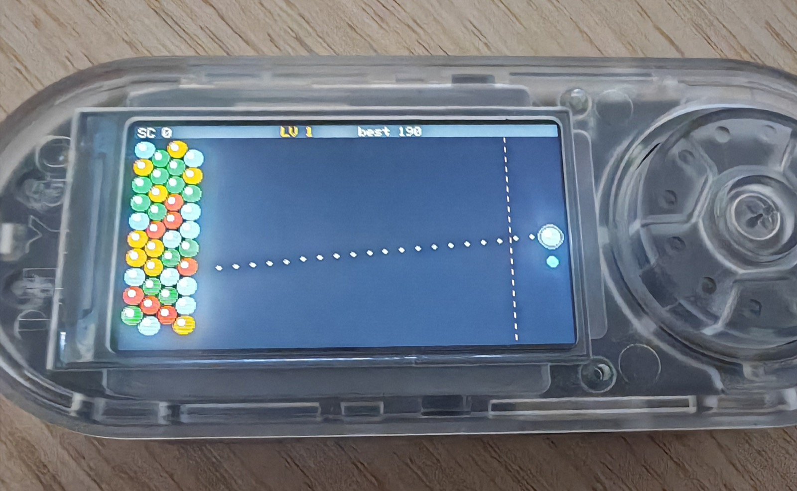
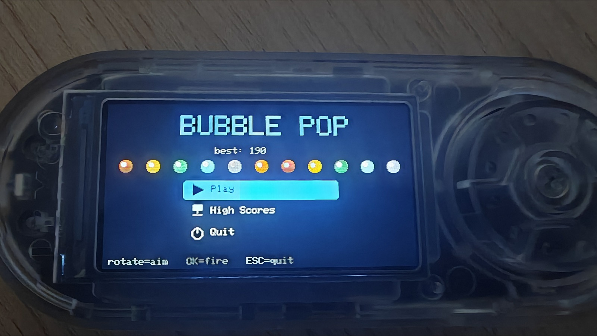

# 🫧 Bubble Pop — Bruce / LilyGO T-Embed CC1101

🇺🇸 <a href="README.md">English</a> · 🇫🇷 <b>Français</b>

  [-F7DF1E)](https://github.com/BruceDevices/firmware) 

Un **casse-bulles** pour l'interpréteur JS de Bruce, pensé pour la molette. Disposé **en paysage** pour l'écran : le mur de bulles est ancré à **gauche**, le canon est à **droite**. Aligne 3 bulles ou plus de même couleur pour les faire éclater, détache des grappes entières, et repousse le mur qui avance.

## 🎮 Contrôles

**Molette = viser (haut/bas)**, **clic = tirer la bulle**, **ESC = menu**. Le pointillé montre le tir qui rebondit sur les bords haut/bas.

## ✨ Fonctions

- 🫧 **Grille hexagonale** — un vrai mur en nid d'abeille. Les tirs s'aimantent à leur place ; **3 bulles ou plus** de même couleur éclatent.
- ⛓️ **Physique des grappes** — fais éclater une chaîne et toutes les bulles qui ne tiennent plus au mur **tombent**, pour des points bonus.
- ⏩ **Mur qui avance** — toutes les quelques tirs, une nouvelle colonne est poussée depuis la gauche. S'il franchit la **ligne rouge** à droite, c'est perdu.
- 🆙 **Niveaux** — plus de couleurs (4 → 6), un mur qui avance plus vite et un mur de départ plus épais à chaque niveau. Flash « LEVEL n ».
- 🎯 **Aperçu de la bulle suivante** au canon ; les couleurs sont toujours tirées parmi celles encore en jeu (la partie reste faisable).
- 🏆 **Top 5 des scores sauvegardé** (`/bubblepop_scores.json`) avec saisie de **3 initiales** en cas de record.
- 🖥️ Affichage sans scintillement, menu à pictos décoré d'une rangée de bulles.

| Menu |
|---|
|  |

## 🚀 Installation

1. Copie **`Bubble Pop.js`** sur la carte SD (par ex. `/scripts` ou `/BruceJS`).
2. Sur l'appareil : **JS Interpreter → sélectionne `Bubble Pop.js`** (ou ajoute-le à tes favoris avec [bruce-launcher](https://github.com/koua29/bruce-launcher)).
3. Les meilleurs scores sont enregistrés dans `/bubblepop_scores.json` sur la SD.

## 🛒 Matériel

*Liens partenaires Amazon : si vous achetez via ces liens, le projet touche une petite commission, sans surcoût pour vous.*

<table>
<tr>
<td align="center" width="33%">
   
  <b><a href="https://www.amazon.fr/dp/B0D45MSMJR?linkCode=ll2&amp;tag=koua29bbubblepop-21&amp;ref_=as_li_ss_tl">Batterie Anker 545 (10 000 mAh)</a></b> Pour faire tourner le T-Embed loin d'une prise
</td>
<td align="center" width="33%">
   
  <b><a href="https://www.amazon.fr/dp/B0C1FCZM94?linkCode=ll2&amp;tag=koua29bbubblepop-21&amp;ref_=as_li_ss_tl">Antenne SMA 433 MHz (lot de 2)</a></b> Antenne sub-GHz pour la radio CC1101
</td>
<td align="center" width="33%">
   
  <b><a href="https://www.amazon.fr/dp/B0B7NVMBPL?linkCode=ll2&amp;tag=koua29bbubblepop-21&amp;ref_=as_li_ss_tl">microSD SanDisk 64 Go (lot de 2)</a></b> Pour les thèmes, scripts et captures Bruce
</td>
</tr>
</table>

En tant que Partenaire Amazon, je réalise un bénéfice sur les achats remplissant les conditions requises.

## 🙏 Crédits & licence

- Script : **koua29**. Tourne sur l'excellent **[Bruce firmware](https://github.com/BruceDevices/firmware)**.
- Publié sous **licence MIT** — voir [LICENSE](LICENSE).

## ☕ Un café ?

